# Projeto Mobile - CookBook
## IADE - Licenciatura em Engenharia Informática | Universidade Europeia
[https://github.com/Gui-KO4/Cookbook](https://github.com/Gui-KO4/Cookbook)

### 1. Equipa (Grupo 3)
| Membro | Número de Estudante |
|---|---|
| André Maleitas | 20251381 |
| Guilherme Soares | 20252152 |
| Henrique Metelo | 20252138 |
| Leandro Santos | 20252147 |

---

## 2. Keywords
- Aplicação
- Mobile
- Receitas
- Culinária
- Despensa
- Comunidade

---

## 3. Descrição da app

O CookBook é um livro de receitas digital colaborativo e gestor de despensa para dispositivos móveis, orientado para a gestão e partilha de **receitas culinárias**. Combina funcionalidades de interação comunitária com ferramentas de apoio à decisão do que cozinhar e do que comprar.

A aplicação permite a **criação, catalogação e armazenamento personalizado de receitas**, dando a cada utilizador controlo sobre a visibilidade dos seus conteúdos (públicos ou privados).

Na vertente social, o sistema integra a gestão de perfis individuais, a exploração de receitas publicadas pela comunidade e o registo de reações (likes, favoritos, avaliações) a outros conteúdos.

Com base na pesquisa de utilizador (secção 7), a solução inclui ainda a **sugestão de receitas a partir dos ingredientes da despensa** que estão prestes a expirar, a geração de **listas de compras** a partir das receitas e um serviço de **geolocalização** com mapeamento de superfícies comerciais próximas.

**Problema que resolve:** muitas pessoas guardam receitas dispersas (capturas de ecrã, cadernos, favoritos), não sabem o que cozinhar e têm pouco tempo para planear as compras. O CookBook reúne tudo num só local, simples e ergonómico.

---

## 4. Público-alvo

O inquérito realizado (84 respostas, secção 7) mostra que o utilizador-alvo são **adultos entre os 48 e os 60 anos** (a faixa dos 50 anos representa 19% dos inquiridos), que **cozinham quase todos os dias** (59%) e têm pouca experiência com aplicações de cozinha (48,8% nunca usaram uma app para gerir despensa ou compras, mas manifestam curiosidade em experimentar).

Trata-se de um público com rotinas de cozinha bem estabelecidas e, por isso, a interface deve ser simples, legível e adaptada a pouca literacia digital. A comunidade da aplicação está aberta a famílias e a qualquer pessoa interessada em culinária.

---

## 5. Pesquisa de mercado

Atualmente existem várias aplicações de gestão de receitas que se aproximam da solução proposta, nomeadamente a **Paprika, Cookpad, Crouton, Cookidoo e Tasty**. Embora cada uma tenha pontos fortes, a sua análise permitiu identificar problemas comuns:

- **Interface pouco intuitiva:** várias aplicações apresentam uma UI arcaica, o que dificulta a utilização, sobretudo para o público-alvo definido.
- **Ausência de interação comunitária:** a generalidade das aplicações carece de mecanismos sociais, como perfis, partilha, reações a conteúdos de outros utilizadores e a possibilidade de os "seguir".

O CookBook preenche estas lacunas com uma interface intuitiva e uma componente social ativa, através de uma comunidade amigável e interativa. **A componente social distingue-nos da concorrência.**

### Avaliação heurística (solução de referência: Paprika)

Para complementar o estudo de mercado, foi realizada uma avaliação heurística da Paprika, no contexto de utilização móvel e sobre os fluxos principais da aplicação. Identificaram-se sobretudo problemas de ergonomia e de design minimalista: navegação no topo do ecrã com áreas de toque pequenas e uma barra superior sobrecarregada de ícones.

**Critério de prioridade**
- **Alta:** afeta tarefas frequentes ou pode causar perda de dados/bloqueio.
- **Média:** causa confusão, mas existe forma de contornar.
- **Baixa:** impacto reduzido ou limitado a utilizadores específicos.

| Problema identificado | Heurística violada | Prioridade | Solução proposta |
|---|---|---|---|
| Barra de navegação na área superior do ecrã e botões com zonas de toque pequenas. | Interação física e ergonomia - HMT 11 | Alta | Colocar a barra de navegação na área inferior e aumentar as dimensões da área de toque dos botões. |
| Na grelha de receitas e no ecrã de detalhes, a barra superior vermelha agrupa demasiados ícones de ação imediata. | Estética e design minimalista - HMT 8 | Média | Simplificar a barra superior, mantendo apenas as ações essenciais. |
| Se o utilizador entrar por engano na área de planeamento de refeições, precisa de passos extra para voltar atrás. | Controlo e liberdade do utilizador - HMT 3 | Média | Incluir um botão visível de "Cancelar / Voltar". |
| Não há tutorial inicial nem ajuda contextual; o suporte está fora da app e é pouco adaptado às tarefas. | Ajuda e documentação - HMT 10 | Média | Criar uma página de ajuda dentro da aplicação. |
| Tarefas repetidas exigem muitos toques. | Flexibilidade e eficiência de utilização - HMT 7 | Baixa | Adicionar ações rápidas, como a seleção múltipla. |

**Evidências observadas (Paprika)**

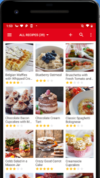

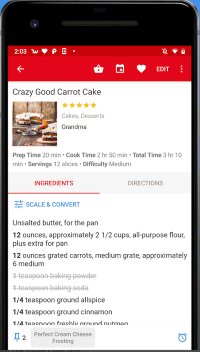

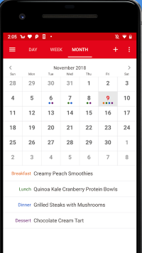

---

## 6. Versão preliminar - Guiões de teste

### **1º Guião** - ***Funcionalidade Core*** - Inserir uma receita na aplicação

**Objetivo** - O utilizador cria uma nova receita no seu perfil.

**Ator** - Utilizador autenticado.

**Pré-requisitos** - O utilizador **tem uma conta e está autenticado**.

1. O utilizador acede ao ecrã inicial e carrega em "Criar nova receita".
2. O sistema abre um novo ecrã para o utilizador escolher os ingredientes.
3. O sistema abre um novo ecrã para o utilizador escrever a receita passo a passo.
4. Por fim, abre um novo ecrã para o utilizador dar detalhes à receita (nome, tempo, dieta, privacidade, imagens ou vídeos).
5. O utilizador carrega no botão "Criar".
6. O sistema mostra uma mensagem de confirmação da criação.

### **2º Guião** - Visualizar uma receita com filtros

**Objetivo** - O utilizador visualiza uma receita utilizando filtros.

**Ator** - Utilizador.

1. O utilizador acede ao ecrã inicial, que é um feed com várias receitas de outros utilizadores.
2. O utilizador carrega no botão para filtrar as receitas.
3. O sistema abre um menu com várias opções de filtros.
4. O utilizador escolhe o filtro que quiser.
5. O sistema atualiza o feed com as receitas filtradas.
6. O utilizador carrega numa receita.
7. O sistema abre um novo ecrã com os detalhes da receita.

### **3º Guião** - Adicionar ingredientes à lista de compras

**Objetivo** - Adicionar ingredientes à lista de compras através de uma receita.

**Ator** - Utilizador autenticado.

**Pré-requisitos** - O utilizador **tem uma conta e está autenticado**.

1. O utilizador acede ao ecrã inicial e escolhe uma receita.
2. O sistema mostra um novo ecrã com os detalhes da receita e a lista de ingredientes.
3. O utilizador carrega no botão para adicionar os ingredientes à lista de compras.
4. O sistema mostra uma mensagem a informar que os ingredientes foram adicionados com sucesso.
5. O utilizador carrega no botão com o seu ícone.
6. O sistema carrega um novo ecrã com os detalhes do utilizador.
7. O utilizador carrega em "A minha lista de compras".
8. O sistema mostra um novo ecrã com a lista de compras do utilizador.

<!-- TODO: considerar um 4º guião para a sugestão de receitas pela despensa (Carla ao fim do dia), já que é a funcionalidade mais validada na pesquisa (RF03). -->

---

## 7. Pesquisa do utilizador

### 7.1 Método
Para compreender os hábitos e as necessidades do público-alvo, realizámos um inquérito através do **Google Forms**, que obteve **84 respostas**. Escolhemos este método por permitir recolher, em pouco tempo, dados de um número considerável de pessoas e identificar padrões de comportamento relacionados com a cozinha, o planeamento de refeições, o desperdício alimentar e a utilização de aplicações.

### 7.2 Perfil dos participantes
As respostas mostram que o utilizador-alvo tem idades maioritariamente entre os 48 e os 60 anos (a faixa dos 50 anos destaca-se com 19% dos inquiridos) e cozinha quase todos os dias (59%). É um público com rotinas de cozinha bem estabelecidas, para quem preparar refeições é uma tarefa diária.

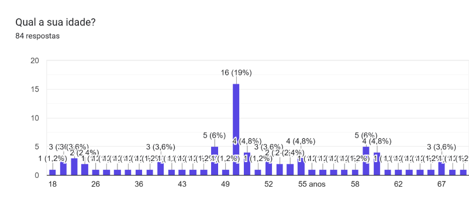

### 7.3 Principais resultados

**Falta de inspiração.** A principal dificuldade apontada é a falta de ideias sobre o que cozinhar (51,2%). Apesar de cozinharem com frequência, sentem dificuldade em variar as refeições.

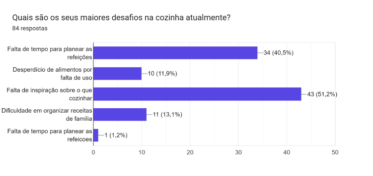

**Desafios principais na cozinha**
- Falta de inspiração sobre o que cozinhar: 51,2% (43 respostas).
- Falta de tempo para planear as refeições: 40,5% (34 respostas).
- Dificuldade em organizar receitas de família: 13,1% (11 respostas).
- Desperdício de alimentos por falta de uso: 11,9% (10 respostas).

**Desperdício alimentar.** Um dos objetivos iniciais da aplicação era ajudar a desperdiçar menos comida. No entanto, a maioria dos inquiridos raramente ou nunca deita fora alimentos por se estragarem (57,1%); os restantes distribuem-se entre desperdício mensal (22,6%) e semanal (20,2%). O desperdício continua a ser um problema relevante, mas não é a principal dor sentida por este público, pelo que **tem um papel secundário** na estratégia da aplicação.

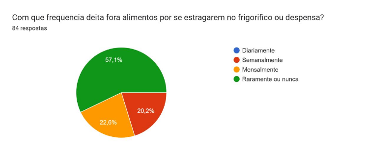

**Armazenamento de receitas.** A maioria guarda as receitas em capturas de ecrã no telemóvel (42,9% / 36 respostas), favoritos no navegador ou redes sociais (39,3% / 33) e cadernos ou livros físicos (34,5% / 29). Uma minoria usa blocos de notas digitais (11,9% / 10). Esta prática dificulta encontrar, organizar e reutilizar receitas, problema que a aplicação resolve ao reuni-las num único local organizado e pesquisável.

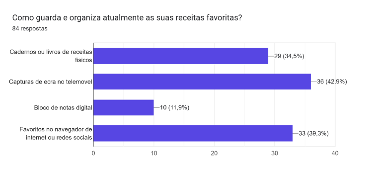

**Utilização de aplicações de cozinha.** A maioria nunca utilizou uma aplicação para gerir a despensa ou as compras (48,8%), mas manifestou curiosidade em experimentar. Dos restantes, 42,9% não sentem necessidade, 4,8% experimentaram mas desinstalaram e 3,6% usam regularmente. Existe, assim, uma oportunidade de mercado clara.

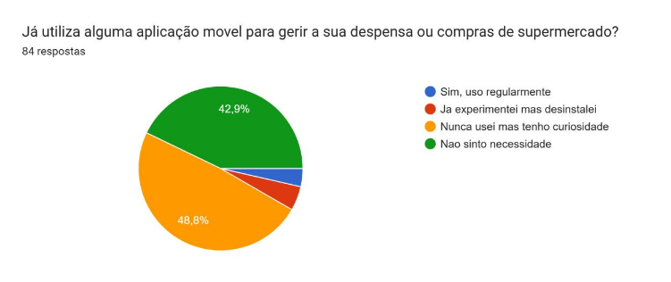

### 7.4 Oportunidade identificada
A funcionalidade com maior potencial é a **sugestão de receitas com base nos ingredientes prestes a expirar na despensa**. Numa escala de 1 a 5, 59,5% (50 respostas) deram a pontuação máxima e 17,9% (15 respostas) deram 4. Esta funcionalidade responde em simultâneo à falta de inspiração (o problema mais referido) e à redução do desperdício.

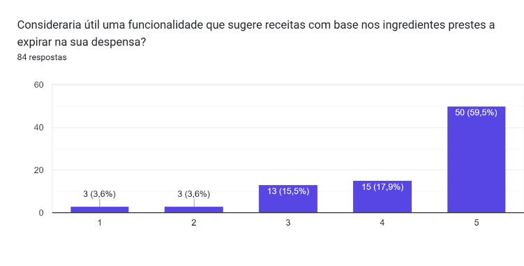

### 7.5 Persona

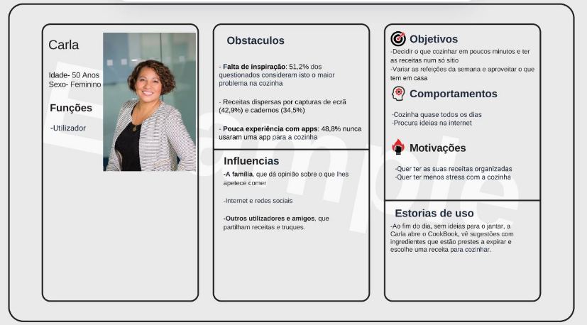

**Carla (50 anos, feminino)**
- **Funções:** utilizadora.
- **Comportamentos:** cozinha quase todos os dias e procura ideias na internet.
- **Objetivos:** decidir o que cozinhar em poucos minutos, ter as receitas num só sítio, variar as refeições da semana e aproveitar o que tem em casa.
- **Motivações:** quer ter as suas receitas organizadas e ter menos stress com a cozinha.
- **Obstáculos:** falta de inspiração (51,2% dos inquiridos consideram-no o maior problema), receitas dispersas por capturas de ecrã (42,9%) e cadernos (34,5%) e pouca experiência com aplicações (48,8% nunca usaram uma app de cozinha).
- **Influências:** a família (que opina sobre o que lhes apetece comer), a internet e redes sociais, e outros utilizadores e amigos que partilham receitas e truques.
- **Estória de uso:** ao fim do dia, sem ideias para o jantar, a Carla abre o CookBook, vê sugestões com ingredientes que estão prestes a expirar e escolhe uma receita para cozinhar.

### 7.6 Mapa de jornada do utilizador

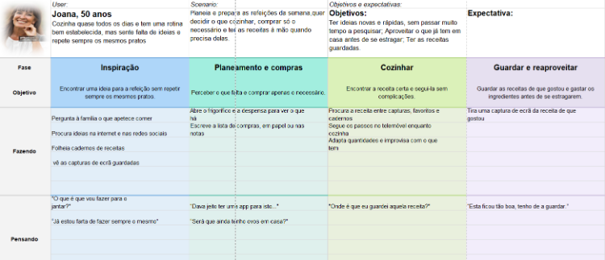

- **Utilizadora:** Carla, 50 anos. Cozinha quase todos os dias e tem uma rotina bem estabelecida, mas sente falta de ideias e repete sempre os mesmos pratos.
- **Cenário:** planeia e prepara as refeições da semana; quer decidir o que cozinhar, comprar só o necessário e ter as receitas à mão quando precisa delas.
- **Objetivos e expectativas:** ter ideias novas e rápidas, sem passar muito tempo a pesquisar; aproveitar o que já tem em casa antes de se estragar; ter as receitas guardadas. Espera encontrar uma aplicação fácil de usar.

| Fase | Objetivo | Ações (fazendo) | Pensamento | Sentimento | Oportunidades |
|---|---|---|---|---|---|
| **Inspiração** | Encontrar uma ideia para a refeição sem repetir sempre os mesmos pratos. | Pergunta à família o que apetece comer; procura ideias na internet e redes sociais; folheia cadernos de receitas e vê capturas de ecrã guardadas. | "O que é que vou fazer para o jantar?"; "Já estou farta de fazer sempre o mesmo". | Frustração (não sabe o que cozinhar). | Sistema de recomendação de receitas populares. |
| **Planeamento e compras** | Perceber o que falta e comprar apenas o necessário. | Abre o frigorífico e a despensa para ver o que tem; escreve a lista de compras em papel ou nas notas. | "Será que ainda tenho ovos em casa?"; "Dava jeito ter uma app para isto". | Cansada (nunca sabe o que tem na despensa). | Funcionalidade de despensa na aplicação. |
| **Cozinhar** | Encontrar a receita certa e segui-la sem complicações. | Procura a receita entre capturas, favoritos e cadernos; segue os passos no telemóvel enquanto cozinha; adapta quantidades e improvisa com o que tem. | "Onde é que eu guardei aquela receita?" | Confusa (não encontra a receita que quer). | Livro de receitas digital centralizado e pesquisável. |
| **Guardar e reaproveitar** | Guardar as receitas de que gosta e gastar os ingredientes antes de se estragarem. | Tira uma captura de ecrã da receita de que gostou. | "Esta ficou tão boa, tenho de a guardar". | Felicidade (gostou e guardou a receita). | Guardar receitas facilmente e sugestões inteligentes de reaproveitamento. |

---

## 8. Motivação e identificação do problema

A pesquisa de utilizador permitiu confirmar e ajustar os problemas que o projeto aborda:

- **Falta de inspiração e monotonia alimentar (51,2%):** o ritmo quotidiano limita o tempo dedicado a variar as refeições, levando à repetição dos mesmos pratos ou ao recurso a soluções pré-confecionadas, menos saudáveis e mais dispendiosas.
- **Receitas dispersas e desorganizadas (42,9% em capturas de ecrã, 34,5% em cadernos):** guardar receitas em vários sítios gera perda de tempo e frustração ao tentar reencontrá-las.
- **Falta de tempo para planear refeições e compras (40,5%):** sem planeamento, há compras redundantes e, em alguns casos, desperdício de alimentos fora do prazo de validade. Embora 42,8% dos inquiridos deitem fora alimentos pelo menos mensalmente, este problema é secundário face aos anteriores.

---

## 9. Proposta de valor e objetivos

1. **Inspiração culinária:** sugerir receitas a partir dos ingredientes da despensa e de uma base de conhecimento colaborativa, simplificando a decisão do que cozinhar.
2. **Organização:** centralizar todas as receitas num livro digital pesquisável e filtrável por ingredientes, tempo, tipo de refeição ou restrições alimentares.
3. **Poupança e sustentabilidade:** ajudar a comprar apenas o necessário, através de listas de compras geradas a partir das receitas, e a aproveitar os ingredientes antes de expirarem.
4. **Comunidade:** permitir a partilha de receitas e truques, com perfis, reações e favoritos.
5. **Economia doméstica (objetivo adicional):** identificar superfícies comerciais próximas e, se possível, investigar a comparação de preços de ingredientes.

---

## 10. Enquadramento nas UCs

| UC | Professor | Contribuição |
|---|---|---|
| Projeto de Desenvolvimento Móvel | Fábio Guilherme | Planeamento e acompanhamento do projeto |
| Programação de Dispositivos Móveis | João Monge | Aplicação Flutter/Dart, servidor Node.js (REST) e integração com a base de dados |
| Bases de Dados | Miguel Boavida | Criação e utilização da base de dados MySQL |
| Redes e Comunicação de Dados | Nathan Campos e Pedro Rosa | Apoio à arquitetura cliente-servidor |
| Interfaces e Usabilidade | Paula Neves | Pesquisa do utilizador, design de interfaces e avaliação de usabilidade |
| Matemática Discreta | André Torcato e Ricardo Sousa | Métodos numéricos e estatística aplicados à análise de dados |

---

## 11. Requisitos

### 11.1 Requisitos funcionais
- **RF01 - Organização de receitas:** o sistema deve permitir criar, editar, catalogar e armazenar receitas num repositório pessoal centralizado, com controlo de visibilidade (pública/privada).
- **RF02 - Pesquisa e filtros:** o sistema deve permitir pesquisar e filtrar receitas por ingredientes disponíveis, tempo de preparação, tipo de refeição ou restrições alimentares.
- **RF03 - Sugestão por validade da despensa:** o sistema deve sugerir receitas automaticamente com base nos ingredientes registados na despensa e nas respetivas datas de validade.
- **RF04 - Lista de compras automática:** o sistema deve permitir exportar os ingredientes de qualquer receita para uma lista de compras personalizável, com suporte para seleção múltipla.
- **RF05 - Comunidade e partilha:** o sistema deve permitir interagir num feed comunitário com reações (likes), comentários, avaliações e opção de guardar em favoritos.
- **RF06 - Mapeamento geolocalizado:** o sistema deve integrar um mapa com a identificação de superfícies comerciais próximas.
- **RF07 - Onboarding e ajuda contextual:** o sistema deve disponibilizar um guia inicial e uma secção de ajuda integrada na aplicação.
- **RF08 - Contas de utilizador:** o sistema deve permitir a criação de contas com autenticação segura e gestão de perfil.

### 11.2 Requisitos não funcionais
- **RNF01 - Legibilidade e contraste:** tipografia clara (tamanho mínimo de 16 pt no corpo de texto) e contraste de cor em conformidade com as normas WCAG AA.
- **RNF02 - Prevenção de erros e reversibilidade:** diálogos de confirmação antes de ações irreversíveis e opções claras para cancelar ou voltar atrás em todos os fluxos.
- **RNF03 - Interface minimalista:** limitar o número de ações primárias visíveis em simultâneo, para evitar a sobrecarga informativa observada na concorrência.
- **RNF04 - Compatibilidade:** o sistema deve ser responsivo e compatível com diferentes dispositivos móveis.
- **RNF05 - Segurança e RGPD:** o sistema deve garantir a segurança dos dados pessoais e das receitas dos utilizadores, em conformidade com o RGPD.

### 11.3 Requisitos específicos do contexto mobile
- **RMB01 - Touch targets adequados:** dimensão mínima de 48x48 dp para botões e ícones clicáveis.
- **RMB02 - Navegação por thumb zone:** navegação principal na área inferior do ecrã (Bottom Navigation Bar), facilitando o alcance com uma só mão.
- **RMB03 - Atalhos e seleção múltipla:** ações rápidas em listas (como despensa e compras) para reduzir o número de toques.

### 11.4 Prioridades de desenvolvimento (MoSCoW)

| Categoria | Requisitos incluídos | Justificação |
|---|---|---|
| **Must Have** *(obrigatório)* | • Autenticação de utilizador<br>• Gestão de receitas (criar/editar)<br>• Feed e filtros de pesquisa<br>• Lista de compras com seleção múltipla<br>• Navegação inferior ergonómica | Funcionalidades nucleares, indispensáveis para resolver os problemas base de organização, pesquisa e ergonomia mobile. |
| **Should Have** *(importante)* | • Sugestões por ingredientes da despensa<br>• Interações sociais (likes, favoritos)<br>• Onboarding e secção de ajuda | Elevado valor acrescentado, validadas na pesquisa de utilizador e resposta direta às falhas de ajuda da concorrência. |
| **Could Have** *(desejável)* | • Mapeamento geolocalizado de lojas próximas | Módulo secundário que enriquece a experiência global. |
| **Won't Have** *(fora do âmbito)* | • Processamento de pagamentos diretos<br>• Integração com carrinhos de compras de supermercados online | Fora do âmbito do semestre por elevada complexidade técnica. |

---

## 12. Estratégia UX

### 12.1 Problemas de usabilidade identificados (avaliação heurística)
- **Ergonomia e áreas de toque deficientes (HMT 11):** navegação principal no topo do ecrã e botões com zonas táteis reduzidas dificultam o uso confortável com uma só mão.
- **Sobrecarga visual (HMT 8):** excesso de ícones de ação na barra superior aumenta a carga cognitiva.
- **Rigidez nos fluxos e falta de controlo (HMT 3):** dificuldade em cancelar ou voltar atrás em ecrãs como o planeamento de refeições.
- **Ausência de apoio ao utilizador (HMT 10):** sem onboarding nem ajuda contextual, penaliza utilizadores com menor literacia digital.
- **Excesso de toques e ineficiência (HMT 7):** tarefas repetitivas exigem demasiados toques por falta de ações rápidas.

### 12.2 Oportunidades de melhoria
- **Centralização inteligente de receitas:** substituir capturas de ecrã e cadernos por um livro de receitas digital, pesquisável e organizado por categorias.
- **Motor de sugestões por ingredientes a expirar:** responder à falta de inspiração com sugestões baseadas na validade dos produtos da despensa (nota máxima de utilidade para 59,5% dos inquiridos).
- **Interface ergonómica e adaptada a pouca literacia digital:** interface limpa, sem termos técnicos complexos e com navegação inferior acessível ao polegar.
- **Diferenciação pela vertente social:** feed comunitário para partilha de receitas, truques de reaproveitamento e reações.
- **Integração fluida entre receita e compras:** envio dos ingredientes de qualquer receita para uma lista de compras interativa com seleção múltipla.

### 12.3 Objetivos de UX
- **Simplicidade e acessibilidade:** utilizadores entre os 48 e os 60 anos (48,8% sem experiência com apps de cozinha) devem conseguir navegar sem hesitação.
- **Redução da carga cognitiva:** barras de ação mais limpas e decisão sobre o que cozinhar em poucos passos.
- **Feedback visual e liberdade do utilizador:** confirmações imediatas para todas as interações e botões claros de "Cancelar / Voltar" em todos os fluxos.

### 12.4 Síntese
A pesquisa mostrou que os utilizadores-alvo sofrem de falta de inspiração e de organização das receitas, e que as aplicações concorrentes têm falhas de ergonomia. Na segunda fase do protótipo, o objetivo é uma interface mais simples, fácil de usar e legível, com tarefas concluídas no mínimo de toques, prevenção de erros e possibilidade de o utilizador regressar às ações anteriores.

---

## 13. Arquitetura da solução

A arquitetura baseia-se numa abordagem cliente-servidor: a aplicação móvel (cliente) comunica com um servidor back-end que processa os pedidos e gere os dados. A comunicação usa uma **API REST**, garantindo uma troca de dados eficiente e segura.

- **Cliente:** aplicação desenvolvida em Flutter (Dart), com interfaces multiplataforma.
- **Servidor:** Node.js, com a estrutura **MVC (Model-View-Controller)** para separar a lógica de negócio, a interface e o controlo de fluxo.
- **Base de dados:** MySQL, para armazenar dados estruturados com integridade e consistência.

### Modelo de domínio

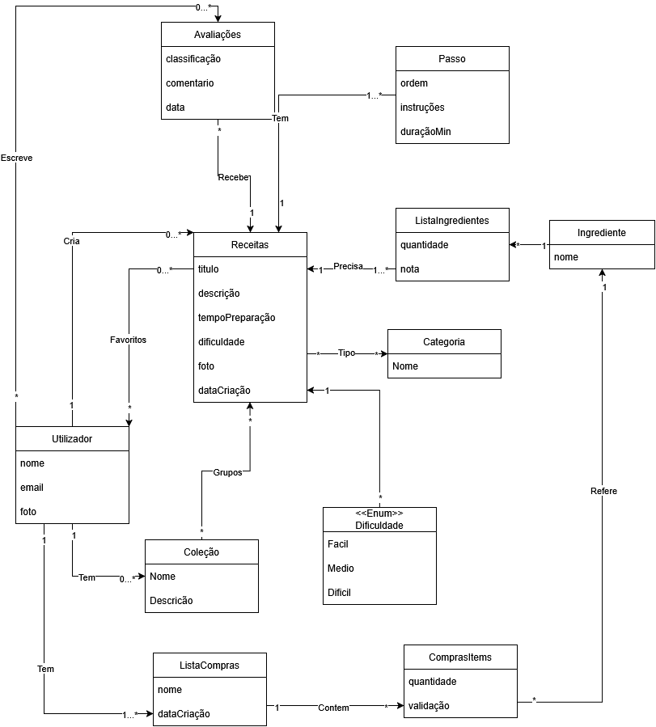

### Diagrama de classes

<!-- TODO (2ª entrega): esboço do diagrama conceptual, com foco nas entidades e nas relações entre elas. -->


---

## 14. Base de dados

### Diagrama entidade-relação

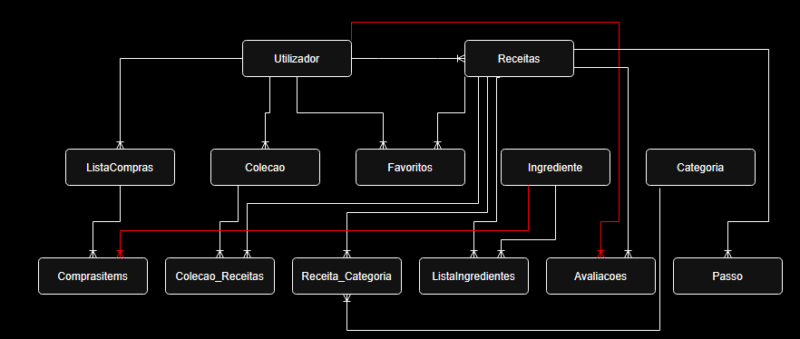

- **Utilizador** - **id_utilizador**, nome, username, email, password_hash, foto, bio, admin_check, data_registo
- **Receitas** - **id_receita**, id_autor, titulo, descricao, tempo_preparacao, tempo_forno, dificuldade, visibilidade, foto, data_criacao
- **Passo** - **id_passo**, id_receita, ordem, instrucoes, duracao_min
- **Ingrediente** - **id_ingrediente**, nome
- **ListaIngredientes** - **id_receita**, **id_ingrediente**, quantidade, unidade, nota
- **Categoria** - **id_categoria**, nome
- **Receita_Categoria** - **id_receita**, **id_categoria**
- **Avaliacoes** - **id_avaliacao**, id_utilizador, id_receita, classificacao, data
- **Favoritos** - **id_utilizador**, **id_receita**, data_added
- **Colecao** - **id_colecao**, id_utilizador, nome, data_criacao
- **Colecao_Receitas** - **id_colecao**, **id_receita**
- **ListaCompras** - **id_lista**, id_utilizador, data_criacao
- **ComprasItems** - **id_item**, id_lista, id_ingrediente, quantidade, check_comprado

<!-- TODO: o RF03 (sugestão por validade) exige uma tabela de despensa (ex.: Despensa: id_utilizador, id_ingrediente, quantidade, data_validade). O RF05 refere comentários, que ainda não têm tabela (ex.: Comentarios). Atualizar o ER e o create.sql. -->

## Dicionário de dados

 ### Utilizador

| Coluna | Tipo |
|---|---|
| id_utilizador (PK) | INT |
| nome | VARCHAR(100) |
| username | VARCHAR(50) |
| email | VARCHAR(150) |
| password_hash | VARCHAR(255) |
| foto | VARCHAR(500) |
| bio | TEXT |
| admin_check | BOOLEAN |
| data_registo | DATETIME |

### Receitas

| Coluna | Tipo |
|---|---|
| id_receita (PK) | INT |
| id_autor (FK) | INT |
| titulo | VARCHAR(150) |
| descricao | TEXT |
| tempo_preparacao | INT |
| tempo_forno | INT |
| dificuldade | ENUM |
| visibilidade | ENUM |
| foto | VARCHAR(500) |
| data_criacao | DATETIME |

### Passo

| Coluna | Tipo |
|---|---|
| id_passo (PK) | INT |
| id_receita (FK) | INT |
| ordem | INT |
| instrucoes | TEXT |
| duracao_min | INT |

### Ingrediente

| Coluna | Tipo |
|---|---|
| id_ingrediente (PK) | INT |
| nome | VARCHAR(100) |

### ListaIngredientes

| Coluna | Tipo |
|---|---|
| id_receita (PK, FK) | INT |
| id_ingrediente (PK, FK) | INT |
| quantidade | DECIMAL(10,2) |
| unidade | VARCHAR(30) |
| nota | VARCHAR(150) |

### Categoria

| Coluna | Tipo |
|---|---|
| id_categoria (PK) | INT |
| nome | VARCHAR(80) |

### Receita_Categoria

| Coluna | Tipo |
|---|---|
| id_receita (PK,FK) | INT | 
| id_categoria (PK,FK) | INT |

### Avaliacoes

| Coluna | Tipo |
|---|---|
| id_avaliacao (PK) | INT |
| id_utilizador (FK) | INT |
| id_receita (FK) | INT |
| classificacao | INT |
| data | DATETIME |

### Favoritos

| Coluna | Tipo |
|---|---|
| id_utilizador (FK) | INT |
| id_receita (FK) | INT |
| data_added | DATETIME |

### Colecao

| Coluna | Tipo |
|---|---|
| id_colecao (PK) | INT |
| id_utilizador (FK) | INT |
| nome | VARCHAR(100) |
| data_criacao | DATETIME |

### Colecao_Receitas

| Coluna | Tipo |
|---|---|
| id_colecao (PK) | INT |
| id_receita (FK) | INT |

### ListaCompras

| Coluna | Tipo |
|---|---|
| id_lista (PK) | INT |
| id_utilizador (FK) | INT |
| data_criacao | DATETIME |

### ComprasItems

| Coluna | Tipo |
|---|---|
| id_item (PK) | INT |
| id_lista (FK) | INT |
| id_ingrediente (FK) | INT |
| quantidade | DECIMAL |
| check_comprado | BOOLEAN |

---
<!-- TODO (2ª entrega): para cada tabela, descrever atributo, tipo, restrições (PK, FK, UNIQUE, NOT NULL, DEFAULT) e descrição. -->

### Guia de dados (BD exemplo)
<!-- TODO (2ª entrega): esboço da estrutura dos dados de exemplo do populate.sql (quantos utilizadores, receitas, ingredientes, etc.). -->

## BD Report
<!-- TODO (2ª entrega): capítulo que descreve a BD do projeto e os dados de exemplo. Ficheiros no GitHub: create.sql, populate.sql, queries.sql. -->
### Entidades Principais:

- Utilizadores: 
    Armazena as credenciais e os dados de perfil dos utilizadores da aplicação.

- Receitas: 
    Armazena os dados de cada receita.

- Ingrediente:
    Catálogo de ingredientes que a base de dados tem disponíveis. Serve de base tanto para as receitas como para as listas de compras.

- Categoria:
    Agrupamentos para classificar as receitas. Permite também o filtro por categoria.

### Entidades Associativas

- Passo: 
    Guarda o passo e a ordem de preparação da receita.

- ListaIngredientes:
    Associa os ingredientes a uma receita, definindo as quantidades de cada um.

- Receita_Categoria:
    Permite que uma receita pertença a várias categorias e que uma categoria tenha várias receitas.

- Avaliações:
    Permite que os utilizadores façam availiações às receitas de outros utilizadores.

- Favoritos:
    Regista as receitas que os utilizadores marcaram como favoritas.

- ListaCompras e ComprasItems:
    Gerem a lista de compras de cada utilizador e os respetivos ingredientes que o utilizador lá meter.

- Coleção e Coleção_Receita:
    Permite aos utilizadores agrupar receitas por coleções personalizadas.


### Chaves Primárias e Estrangeiras

- Chaves Primárias: 
    As Entidades principais e as Entidades "Avaliações", "Passo", "ListaCompras", "Coleção" e "ComprasItems" usam chaves primárias para garantir identificadores únicos.(id_utilizador, id_receita, id_ingrediente, id_avaliacao, id_passo, id_lista, id_colecao, id_item)

- Chaves Estrangeiras:
    Várias entidades utilizam chaves estrangeiras que referenciam outras entidades:  
        - Receita: utiliza a chave estrangeira "id_author", que referencia a entidade Utilizador(id_author = id_utilizador)  
        - Passo: utiliza a chave estrangeira "id_receita", que referencia a a entidade Receita  
        - ListaIngredientes: utiliza as chaves estrangeiras "id_receita" e "id_ingrediente", que referenciam as entidades Receita e Ingrediente  
        - Receita_Categoria: utiliza as chaves estrangeiras "id_receita" e "id_categoria", que referenciam as entidades Receita e Categoria  
        - Avalições: utiliza as chaves estrangeiras "id_utilizador" e "id_receita", que referenciam as entidades Utilizador e Receita  
        - Favoritos: utiliza as chaves estrageiras "id_utilizador" e "id_receita", que referenciam as entidades Utilizador e Receita  
        - Coleção: utiliza a chave estrangeira "id_utilizador", que referencia a entidade Utilizador  
        - Coleção_Receitas: utiliza as chaves estrangeiras "id_colecao" e "id_receita", que referenciam as entidades Coleção e Receita  
        - ListaCompras: utiliza a chave estrangeira "id_utilizador", que referencia a entidade Utilizador  
        - ComprasItems: utiliza as chaves estrangeiras "id_lista" e "id_ingrediente", que referenciam as entidades ListaCompras e Ingrediente  
---

## 15. Documentação REST

<!-- TODO (2ª entrega): primeira versão no formato https://bocoup.com/blog/documenting-your-api
Para cada endpoint: título, URL, método, parâmetros (URL e dados), resposta de sucesso, resposta de erro, exemplo de chamada, notas. -->

---

## 16. Tecnologias

| Função | Tecnologia |
|---|---|
| Aplicação móvel | Flutter, Dart |
| Back-end | Node.js, JavaScript |
| Base de dados | MySQL, MAMP |
| Design | Figma |
| Gestão e versões | GitHub, GitHub Projects |

    

---

## 17. Planeamento e calendarização

| Entrega | Data | Conteúdo |
|---|---|---|
| Primeira entrega | 02/10/2026 | Relatório da proposta do projeto, mockups, requisitos |
| Segunda entrega | 06/11/2026 | Protótipo funcional com BD e servidor, relatório atualizado |
| Terceira entrega | 11/12/2026 | Versão final do projeto, relatório e suportes visuais |

### WBS (Work Breakdown Structure)
```
1.0 Cookbook
    1.1 Gestão e Documentação
        1.1.1 Proposta de Projeto e Relatório Intermédio
        1.1.2 Planeamento no GitHub Projects
    1.2 Design e Interfaces (Figma)
        1.2.1 Pesquisa do Utilizador, Guiões de Teste e Personas
        1.2.2 Avaliação Heurística
        1.2.3 Wireframes e Mockups de Alta Fidelidade
    1.3 Base de Dados (MySQL)
        1.3.1 Diagrama Entidade-Relação (ER) e Dicionário de Dados
        1.3.2 Scripts de Criação, Povoamento e Queries
    1.4 Servidor Back-End (Node.js & REST)
        1.4.1 Configuração da Arquitetura MVC
        1.4.2 Endpoints de Autenticação e Receitas
    1.5 Aplicação Móvel (Flutter & Dart)
        1.5.1 Ecrã de Autenticação e Perfil
        1.5.2 Feed e Filtros de Receitas
        1.5.3 Módulo de Criação de Receitas
        1.5.4 Lista de Compras
        1.5.5 Despensa e Sugestões por Validade
```

### Project Charter

#### 1. Justificação e descrição sumária
O projeto pretende preencher a falta de ferramentas integradas que combinem a gestão personalizada de receitas com a partilha social, a gestão da despensa e o mapeamento de superfícies comerciais. Visa incentivar o planeamento das refeições, ajudar a decidir o que cozinhar e a organizar os hábitos culinários dos utilizadores.

#### 2. Objetivos do projeto
- Desenvolver uma aplicação móvel funcional e responsiva em Flutter/Dart.
- Implementar uma arquitetura cliente-servidor com back-end Node.js (REST) e base de dados relacional MySQL.
- Integrar geolocalização e mapas para localizar estabelecimentos comerciais próximos.
- Garantir interfaces intuitivas, validadas por critérios de usabilidade e testes com utilizadores.

#### 3. Âmbito do projeto

**Em âmbito**
- Registo, autenticação segura e gestão de perfil de utilizador.
- Criação, edição, remoção e catalogação de receitas, com controlo de visibilidade (pública/privada).
- Feed de receitas comunitárias com pesquisa e filtros.
- Sistema de reações (likes, favoritos, avaliações).
- Geração e gestão de listas de compras a partir das receitas.
- Despensa e sugestão de receitas por ingredientes a expirar.
- Mapeamento geolocalizado de estabelecimentos comerciais próximos.
- Investigação de modelos de comparação de preços de ingredientes.

**Fora de âmbito**
- Processamento de pagamentos ou compras diretas dentro da aplicação.
- Gestão logística de encomendas ou entregas ao domicílio.
- Integração obrigatória com inventários em tempo real de cadeias de retalho (serão usados dados simulados caso não existam APIs públicas).

#### 4. Marcos principais

| Milestone | Data limite | Entregável principal |
|---|---|---|
| **M1: Proposta de projeto** | 02/10/2026 | Proposta formal (.md e PDF), WBS, Gantt e mockups no Figma |
| **M2: Protótipo funcional** | 06/11/2026 | Versão alfa (Flutter + Node.js REST + MySQL), scripts SQL e dicionário de dados |
| **M3: Versão final** | 11/12/2026 | Aplicação final no telemóvel, manual do utilizador, vídeo, poster e relatório final |

#### 5. Premissas e restrições
- **Tecnológicas:** uso obrigatório de Flutter, Dart, Figma, Node.js, MySQL e arquitetura MVC/REST.
- **Metodológicas:** gestão do trabalho via GitHub Projects e controlo de versões em Git/GitHub.
- **Dados:** dados fictícios/simulados para testes e povoamento da base de dados (RGPD).

#### 6. Riscos iniciais e mitigação

| Risco identificado | Impacto | Estratégia de mitigação |
|---|---|---|
| Inexistência de APIs públicas e gratuitas de preços de supermercados | Alto | Criar serviços mock/estruturas de dados internas para simular a comparação de preços. |
| Público-alvo com pouca literacia digital pode ter dificuldade em usar a app | Médio | Onboarding, ajuda contextual, navegação inferior e testes de usabilidade com utilizadores. |

### Gráfico de Gantt e cronograma de tarefas

O cronograma foi estruturado no GitHub Projects, que funciona como Gráfico de Gantt:

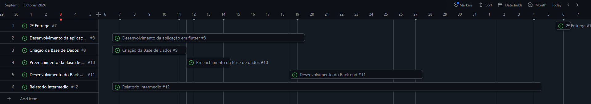

---

## 18. Conclusão

O projeto CookBook responde de forma prática e intuitiva aos desafios da organização alimentar diária: a falta de inspiração sobre o que cozinhar, a dispersão das receitas e a falta de tempo para planear as compras. Ao superar as limitações das aplicações concorrentes, nomeadamente as interfaces pouco acessíveis e a escassez de mecanismos sociais, posiciona-se como uma plataforma colaborativa que valoriza a partilha comunitária e a organização personalizada de receitas.

A pesquisa de utilizador permitiu ajustar o âmbito: a sugestão de receitas pela despensa (validada por 77,4% dos inquiridos com nota 4 ou 5) e a ergonomia mobile passam a ser prioridades, enquanto o desperdício alimentar assume um papel secundário.

Com a segunda fase, ficam consolidados o levantamento de requisitos, a pesquisa de utilizador, a arquitetura cliente-servidor e a modelação da base de dados. A equipa foca-se agora na implementação dos serviços REST, no protótipo funcional e na validação da usabilidade, com vista à entrega final.

Ao longo do desenvolvimento, a equipa pretende ainda investigar um comparador de preços de ingredientes entre estabelecimentos comerciais, como vertente diferenciadora que aprofunda o uso de APIs externas e a análise comparativa de dados.

---

## 19. Bibliografia

### Tecnologias e plataformas
- **Dart Dev.** (s.d.). *Dart programming language documentation*. Recuperado de https://dart.dev/guides
- **Flutter Dev.** (s.d.). *Flutter documentation: Beautiful native apps in record time*. Google. Recuperado de https://docs.flutter.dev/
- **GitHub.** (s.d.). *GitHub Projects documentation: Planning and tracking work*. Recuperado de https://docs.github.com/en/issues/planning-and-tracking-with-projects
- **MySQL.** (2024). *MySQL 8.0 Reference Manual*. Oracle Corporation. Recuperado de https://dev.mysql.com/doc/refman/8.0/en/
- **Node.js.** (s.d.). *Node.js documentation & API reference*. OpenJS Foundation. Recuperado de https://nodejs.org/docs/latest/api/

### Aplicações de referência e análise de mercado
- **Cookidoo.** (s.d.). *Plataforma oficial de receitas Bimby*. Vorwerk International. Recuperado de https://cookidoo.pt/
- **Cookpad Inc.** (s.d.). *Cookpad: Receitas e comunidade culinária*. Recuperado de https://cookpad.com/pt
- **Hindsight Labs LLC.** (s.d.). *Paprika Recipe Manager 3*. Recuperado de https://www.paprikaapp.com/
- **Tasty.** (s.d.). *Tasty: Food and recipe network*. BuzzFeed, Inc. Recuperado de https://tasty.co/
