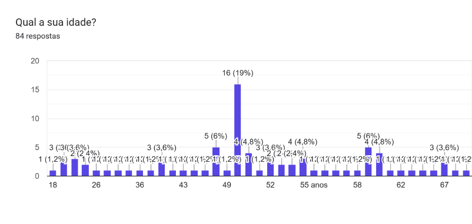
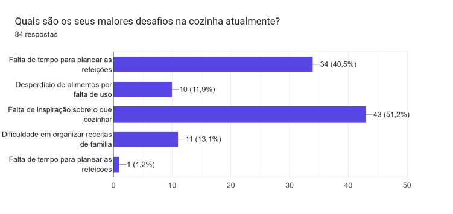
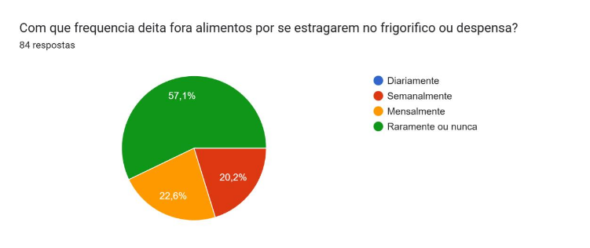
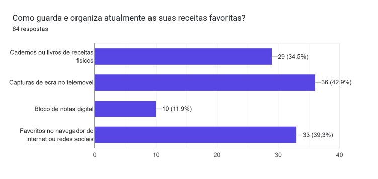
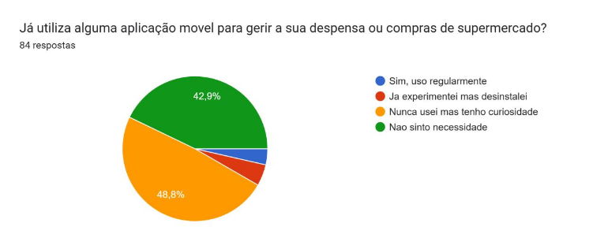
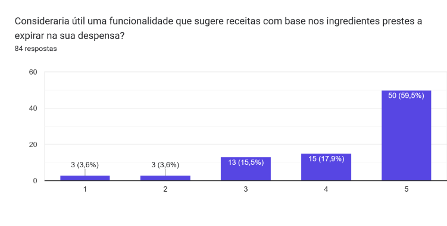
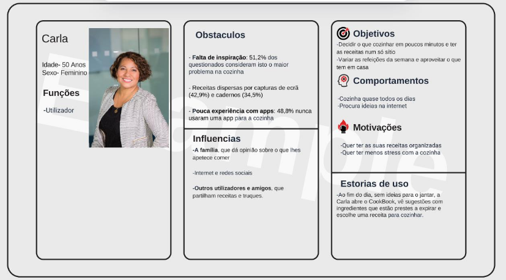
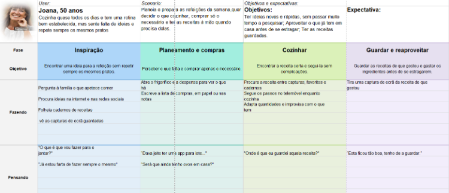

# Relatorio de interfaces e usabilidade 

## Iade - Licenciatura de Engenharia Informática

## Grupo 3 

| Membro| Número de Estudante|
|---|---|
| André Maleitas | 20251381 |
| Guilherme Soares | 20252152 |
| Henrique Metelo | 20252138 |
| Leandro Santos | 20252147 |

# Background

## Descrição 

O quê?:
A aplicação é um livro de receitas digital colaborativo e gestor de despensa para dispositivos móveis. A plataforma permite aos utilizadores organizar receitas pessoais e familiares, planear refeições semanais de forma eficiente e interagir através de uma comunidade ativa focada na partilha de receitas práticas e truques de reaproveitamento.

Porquê?:
Surge da necessidade diária que muitas famílias e jovens têm em gerir as suas rotinas alimentares com pouco tempo disponível, associada ao problema crítico do desperdício alimentar doméstico. Grande parte deste desperdício resulta da ausência de planeamento das compras e do desconhecimento sobre como combinar e rentabilizar os ingredientes já disponíveis em casa antes do fim da validade.

## Visão

Objetivo Ideal:
O objetivo do CookBook é ser a aplicação de referência para o dia a dia na cozinha, juntando num só sítio o planeamento das refeições, a partilha de receitas e a ajuda nas compras de supermercado de forma simples e intuitiva.

Benefícios para o Público-Alvo (Famílias e Jovens):

Poupança e Menos Desperdício: Ajuda a aproveitar os ingredientes que já existem em casa antes de se estragarem e a comprar apenas o necessário.

Menos Stress no Dia a Dia: Acaba com a dúvida do "o que fazer para o jantar?", dando sugestões rápidas e variadas para a rotina diária.

Comunidade e Partilha: Permite descobrir novas ideias, guardar os pratos favoritos e trocar dicas úteis com outros utilizadores.

## Concorrência

Atualmente existem várias aplicações de gestão de receitas que se aproximam da solução proposta, nomeadamente a Paprika, Cookpad, Crouton, Cookidoo e Tasty. Embora cada uma tenha pontos fortes, a análise destas soluções permitiu identificar problemas comuns:

Interface pouco intuitiva: várias das aplicações analisadas apresentam uma UI bastante arcaica o que dificulta a utilização, sobretudo pelos utilizadores que temos definidos como publico-alvo. Ausência de interação comunitária: a generalidade das aplicações carece de mecanismos sociais, como perfis, partilha e reações a conteúdos de outros utilizadores e a habilidade de "seguir" os mesmos.

A aplicação Cookbook visa preencher estas lacunas, oferecendo uma interface intuitiva e uma componente social ativa, através de uma comunidade amigável e interativa. Esta permite aos utilizadores partilhar receitas e reagir aos conteúdos de outros utilizadores, proporcionando uma experiência mais rica e envolvente.

A componente social da aplicação distingue-nos da concorrência.

# Pesquisa do Utilizador
## Método
Para compreender os hábitos e as necessidades do público-alvo, realizámos um inquérito através do Google Forms, que obteve 84 respostas. Escolhemos este método por permitir recolher, em pouco tempo, dados de um número considerável de pessoas e identificar padrões de comportamento relacionados com a cozinha, o planeamento de refeições, o desperdício alimentar e a utilização de aplicações.

## Perfil dos Participantes
A análise das respostas permitiu perceber que o utilizador-alvo da aplicação são pessoas com idades maioritariamente entre os 48 e os 60 anos (destacando-se a faixa dos 50 anos com 19% dos inquiridos), que cozinham quase todos os dias (59% dos inquiridos). Trata-se, portanto, de um público com rotinas de cozinha bem estabelecidas e para quem a preparação de refeições é uma tarefa diária.

## Principais Resultados

- **Falta de Inspiração:** A principal dificuldade apontada pelos inquiridos é a falta de ideias sobre o que cozinhar (51,2%). Apesar de cozinharem com frequência, sentem dificuldade em variar as refeições, o que reforça a necessidade de uma aplicação como o CookBook.

- **Desafios Principais na Cozinha:**
  * Falta de inspiração sobre o que cozinhar: 51,2% (43 respostas).
  * Falta de tempo para planear as refeições: 40,5% (34 respostas).
  * Dificuldade em organizar receitas de família: 13,1% (11 respostas).
  * Desperdício de alimentos por falta de uso: 11,9% (10 respostas).

- **Desperdício Alimentar:** Um dos objetivos iniciais da aplicação era ajudar o utilizador a desperdiçar menos comida. No entanto, a análise das respostas mostrou que a maioria dos inquiridos raramente ou nunca deita fora alimentos por se estragarem (57,1%). Os restantes distribuem-se entre desperdício mensal (22,6%) e semanal (20,2%). Este resultado indica que o desperdício, embora continue a ser um problema relevante, não é a principal dor sentida por este público, pelo que deverá ter um papel secundário na estratégia da aplicação.

- **Armazenamento de Receitas:** Verificámos que a maioria das pessoas guarda as suas receitas sob a forma de capturas de ecrã no telemóvel (42,9% / 36 respostas), mantendo também favoritos no navegador ou redes sociais (39,3% / 33 respostas) e cadernos ou livros de receitas físicos (34,5% / 29 respostas). Uma menor percentagem recorre a blocos de notas digitais (11,9% / 10 respostas). Esta prática torna difícil encontrar, organizar e reutilizar receitas, sendo um problema que a nossa aplicação resolve diretamente ao reunir todas as receitas num único local organizado e pesquisável.

- **Utilização de Aplicações de Cozinha:** A maioria dos inquiridos nunca utilizou uma aplicação dedicada a gerir a despensa ou compras de supermercado (48,8%), mas manifestou curiosidade em experimentar. Por outro lado, 42,9% indicaram não sentir necessidade, 4,8% já experimentaram mas desinstalaram e 3,6% usam regularmente. Existe, assim, uma clara oportunidade de mercado para a nossa aplicação.

## Oportunidades Identificadas
Com base nos resultados, identificámos uma funcionalidade com bastante potencial: a sugestão de receitas com base nos ingredientes prestes a expirar na despensa do utilizador. Quando questionados se considerariam útil esta funcionalidade numa escala de 1 a 5, a grande maioria dos inquiridos avaliou a ideia com a pontuação máxima de 5 (59,5% / 50 respostas) e 4 (17,9% / 15 respostas). Esta funcionalidade responde em simultâneo à falta de inspiração (o problema mais referido) e à redução do desperdício.

## Persona

### Carla (50 Anos, Feminino)
- **Funções:** Utilizador.
- **Comportamentos:** Cozinha quase todos os dias e procura ideias na internet.
- **Objetivos:** Decidir o que cozinhar em poucos minutos, ter as receitas num só sítio, variar as refeições da semana e aproveitar o que tem em casa.
- **Motivações:** Quer ter as suas receitas organizadas e ter menos stress com a cozinha.
- **Obstáculos:** Falta de inspiração (51,2% dos questionados consideram isto o maior problema), receitas dispersas por capturas de ecrã (42,9%) e cadernos (34,5%), e pouca experiência com aplicações (48,8% nunca usaram uma app para a cozinha).
- **Influências:** A família (que dá opinião sobre o que lhes apetece comer), a internet/redes sociais, e outros utilizadores e amigos que partilham receitas e truques.
- **Estória de uso:** Ao fim do dia, sem ideias para o jantar, a Carla abre o CookBook, vê sugestões com ingredientes que estão prestes a expirar e escolhe uma receita para cozinhar.

## User Journey Map (Mapa de Jornada do Utilizador)

- **User:** Joana, 50 anos. Cozinha quase todos os dias e tem uma rotina bem estabelecida, mas sente falta de ideias e repete sempre os mesmos pratos.
- **Cenário:** Planeia e prepara as refeições da semana; quer decidir o que cozinhar, comprar só o necessário e ter as receitas à mão quando precisa delas.
- **Objetivos & Expectativas:** Ter ideias novas e rápidas, sem passar muito tempo a pesquisar; aproveitar o que já tem em casa antes de se estragar; ter as receitas guardadas. Expectativa de encontrar uma aplicação fácil de usar.

| Fase | Objetivo | Ações (Fazendo) | Pensamento | Sentimento | Oportunidades |
|---|---|---|---|---|---|
| **Inspiração** | Encontrar uma ideia para a refeição sem repetir sempre os mesmos pratos[cite: 5]. | Pergunta à família o que apetece comer; procura ideias na internet e redes sociais; folhea cadernos de receitas e vê capturas de ecrã guardadas[cite: 5]. | "O que é que vou fazer para o jantar?"; "Já estou farta de fazer sempre o mesmo"[cite: 5]. | Frustração (não sabe o que cozinhar)[cite: 5]. | Sistema de recomendação de receitas populares[cite: 5]. |
| **Planeamento e Compras** | Perceber o que falta e comprar apenas o necessário[cite: 5]. | Abre o frigorífico e despensa para ver o que tem; escreve a lista de compras em papel ou nas notas[cite: 5]. | "Será que ainda tenho ovos em casa?"; "Dava jeito ter uma app para isto"[cite: 5]. | Cansada (nunca sabe o que tem na despensa)[cite: 5]. | Funcionalidade de despensa na aplicação[cite: 5]. |
| **Cozinhar** | Encontrar a receita certa e segui-la sem complicações[cite: 5]. | Procura a receita entre capturas, favoritos e cadernos; segue os passos no telemóvel enquanto cozinha; adapta quantidades e improvisa com o que tem[cite: 5]. | "Onde é que eu guardei aquela receita?"[cite: 5]. | Confusa (não encontra a receita que quer)[cite: 5]. | Livro de receitas digital centralizado e pesquisável[cite: 5]. |
| **Guardar e Reaproveitar** | Guardar as receitas de que gosta e gastar os ingredientes antes de se estragarem[cite: 5]. | Tira uma captura de ecrã da receita de que gostou[cite: 5]. | "Esta ficou tão boa, tenho de a guardar"[cite: 5]. | Felicidade (gostou e guardou a receita)[cite: 5]. | Guardar receitas facilmente e sugestões inteligentes de reaproveitamento[cite: 5]. |
| **Inspiração** | Encontrar uma ideia para a refeição sem repetir sempre os mesmos pratos. | Pergunta à família o que apetece comer; procura ideias na internet e redes sociais; folhea cadernos de receitas e vê capturas de ecrã guardadas. | "O que é que vou fazer para o jantar?"; "Já estou farta de fazer sempre o mesmo". | Frustração (não sabe o que cozinhar). | Sistema de recomendação de receitas populares. |
| **Planeamento e Compras** | Perceber o que falta e comprar apenas o necessário. | Abre o frigorífico e despensa para ver o que tem; escreve a lista de compras em papel ou nas notas. | "Será que ainda tenho ovos em casa?"; "Dava jeito ter uma app para isto". | Cansada (nunca sabe o que tem na despensa). | Funcionalidade de despensa na aplicação. |
| **Cozinhar** | Encontrar a receita certa e segui-la sem complicações. | Procura a receita entre capturas, favoritos e cadernos; segue os passos no telemóvel enquanto cozinha; adapta quantidades e improvisa com o que tem. | "Onde é que eu guardei aquela receita?". | Confusa (não encontra a receita que quer). | Livro de receitas digital centralizado e pesquisável. |
| **Guardar e Reaproveitar** | Guardar as receitas de que gosta e gastar os ingredientes antes de se estragarem. | Tira uma captura de ecrã da receita de que gostou. | "Esta ficou tão boa, tenho de a guardar". | Felicidade (gostou e guardou a receita). | Guardar receitas facilmente e sugestões inteligentes de reaproveitamento. |

# Avaliação Heurística (Solução de Referência: Paprika)
Para complementar os dados do estudo de mercado e obter uma perspetiva especializada sobre a experiência de utilização da aplicação, foi realizada uma avaliação heurística da solução digital Paprika (concorrente). A avaliação teve em conta o contexto de utilização móvel, analisando de forma sistemática os fluxos principais da aplicação.

## Analise Sistemática da Interface
Durante a avaliação, foi identificado que o design da aplicação Paprika apresenta, sobretudo, problemas de ergonomia e um design minimalista, nomeadamente, na navegação colocada no topo do ecrã, com áreas de toque pequenas, e numa barra superior sobrecarregada de ícones. No entanto, não falha em muitos tópicos das heurísticas.

## Critério de Prioridade
- Alta: Afeta tarefas frequentes ou pode causar perda de dados/bloqueio.
- Média: Causa confusão, mas existe forma de contornar.
- Baixa: Impacto reduzido ou limitado a utilizadores específicos.

## Problemas Identificados e Soluções Propostas

| Problema Identificado                                                                                                      | Heurística Violada                               | Prioridade | Solução                                                                                                                                 |
| -------------------------------------------------------------------------------------------------------------------------- | ------------------------------------------------ | ---------- | --------------------------------------------------------------------------------------------------------------------------------------- |
| Barra de Navegação na area superior da tela e botões com zonas de toque pequenas.                                          | Interacção física e ergonomia - HMT 11           | Alta       | Colocar a barra de Navegação na area inferior da aplicação movel para facil acesso e aumentar as dimensões da area de toque dos botões. |
| Na grelha de receitas e no ecrã de detalhes, a barra superior vermelha agrupa demasiados ícones de ação imediata.          | Estética e design minimalista - HMT 8            | Média      | Simplificar a barra superior mantendo apenas ações essenciais                                                                           |
| Se o utilizador clicar na area de planeamento de comida por engano, precisa de fazer passos extra para poder voltar atras. | Controlo e liberdade do utilizador - HMT 3       | Média      | Incluir um botão visível de "Cancelar / Voltar"                                                                                         |
| Não há tutorial inicial nem ajuda contextual; o suporte está fora da app e é pouco adaptado às tarefas.                    | Ajuda e documentação -HMT 10                     | Média      | Criar uma pagina na aplicação movél para ajuda do utilizador                                                                            |
| Tarefas repetidas que exigem muitos toques podendo ser reduzidas.                                                          | Flexibilidade e eficiência de utilização - HMT 7 | Baixa      | Adicionar ações rápidas como seleção múltipla reduzindo toques extra.                                                                   |

## Imagens de Referência para as evidencias observadas

# Requisitos e estratégia UX

## Necessidades e problemas prioritários dos utilizadores

- **Falta de Inspiração Diária:** 51,2% dos inquiridos referem a falta de ideias sobre o que cozinhar como o principal desafio no dia a dia.
- **Dispersão e Desorganização de Receitas:** 42,9% guardam receitas em capturas de ecrã e 34,5% em cadernos físicos, gerando perda de tempo, desorganização e frustração ao tentar reencontrar um prato.
- **Dificuldade no Planeamento e Gestão de Tempo:** 40,5% apontam a falta de tempo para planear as refeições e organizar as compras semanais como uma dor relevante.

## Problemas de usabilidade identificados

- **Problemas na Concorrência:** Interfaces arcaicas, navegação pouco intuitiva e ausência de mecanismos comunitários e de partilha social simples (ex.: *Paprika*, *Cookpad*).
- **Oportunidades de Melhoria:** Desenvolver uma interface moderna e acessível para utilizadores com pouca experiência digital, integrando um motor de sugestão automática baseado na validade dos ingredientes da despensa.

## Oportunidades de melhorias

Com base no cruzamento entre os dados da User Research, o perfil da Persona e a análise da concorrência, identificaram-se as seguintes oportunidades chave para o design e desenvolvimento do CookBook:

- **Centralização Inteligente de Receitas:** 
  * *Oportunidade:* Substituir o hábito disperso de guardar receitas em capturas de ecrã (42,9%) e cadernos físicos (34,5%) por um "Livro de Receitas Digital" centralizado, pesquisável e organizado por categorias.

- **Motor de Sugestões Baseado em Ingredientes a Expirar:** 
  * *Oportunidade:* Responder à principal dor do utilizador (51,2% refere falta de inspiração) através de um algoritmo que sugere pratos com base na validade dos produtos na despensa. Esta funcionalidade obteve um acolhimento extremamente positivo no inquérito, com 59,5% dos inquiridos a classificá-la com a pontuação máxima de utilidade (5/5).

- **Interface Adaptada a Utilizadores com Pouca Literacia Digital:** 
  * *Oportunidade:* Como 48,8% dos inquiridos nunca usou uma app de cozinha e a faixa etária predominante situa-se entre os 48 e os 60 anos, existe a oportunidade de desenhar uma interface limpa, intuitiva e sem termos técnicos complexos, facilitando a adoção do produto.

- **Diferenciação pela Vertente Comunitária e Social:** 
  * *Oportunidade:* Superar a concorrência direta (como Paprika ou Cookpad), que apresenta interfaces arcaicas e ausência de interação social, oferecendo um feed comunitário para partilha de receitas, truques de reaproveitamento e reações (*likes* e favoritos).

- **Integração Fluida entre Receita e Planeamento de Compras:** 
  * *Oportunidade:* Resolver o problema da falta de tempo para planear refeições (40,5%) através do envio automático dos ingredientes de qualquer receita diretamente para uma lista de compras interativa.

- **Assistente de Confeção ("Modo Cozinha"):** 
  * *Oportunidade:* Melhorar a experiência no momento de cozinhar (evitando a confusão de procurar a receita enquanto se prepara os alimentos), disponibilizando um modo de ecrã sempre ativo (*Keep Screen On*) com os passos de preparação apresentados de forma clara e faseada.

## Objetivos de UX

- **Simplicidade e Acessibilidade:** Garantir que utilizadores entre os 48 e 60 anos (dos quais 48,8% nunca usaram aplicações de cozinha) consigam navegar sem hesitação.
- **Redução da Carga Cognitiva:** Permitir que a decisão do que cozinhar ao fim do dia seja tomada de forma intuitiva e em menos de 3 passos na aplicação.
- **Feedback Visual Claro:** Fornecer confirmações imediatas para todas as interações (ex.: ao adicionar ingredientes à lista de compras ou guardar receitas).

## Requisitos funcionais

- **RF01 - Organização de Receitas:** O sistema deve permitir criar, editar, catalogar e armazenar receitas num repositório pessoal centralizado.
- **RF02 - Pesquisa e Filtros:** O sistema deve permitir pesquisar e filtrar receitas por ingredientes disponíveis, tempo de preparação, tipo de refeição ou restrições alimentares.
- **RF03 - Sugestão por Validade da Despensa:** O sistema deve sugerir receitas automaticamente com base nos ingredientes registados na despensa e nas suas respetivas datas de validade.
- **RF04 - Lista de Compras Automática:** O sistema deve permitir exportar os ingredientes de qualquer receita diretamente para uma lista de compras personalizável.
- **RF05 - Comunidade e Partilha:** O sistema deve permitir interagir num feed comunitário com reações (*likes*), comentários e opção de guardar em favoritos.
- **RF06 - Mapeamento Geolocalizado:** O sistema deve integrar um mapa de geolocalização com a identificação de superfícies comerciais próximas.

## Requisitos de experiência, usabilidade e acessibilidade

- **RNF01 - Legibilidade e Contraste:** Utilização de tipografia clara (tamanho mínimo de 16pt no corpo de texto) e contraste de cor adequado em conformidade com as normas WCAG AA.
- **RNF02 - Prevenção de Erros:** Diálogos de confirmação antes de ações irreversíveis (ex.: eliminar uma receita ou limpar a lista de compras).

## Requisitos específicos do contexto mobile

- **RMB01 - Touch Targets Ergonomicamente Adequados:** Dimensão mínima de 48x48 dp para botões e ícones clicáveis.
- **RMB02 - Navegação por Thumb Zone:** Estrutura principal baseada numa *Bottom Navigation Bar* acessível ao alcance do polegar.
- **RMB03 - Modo de Cozinha (Ecrã Ativo):** Funcionalidade para manter o ecrã ligado (*Keep Screen On*) durante a visualização do passo a passo de uma receita.

## Prioridades para o desenvolvimento da solução

| Categoria | Requisitos Incluídos | Justificação |
|---|---|---|
| **Must Have** *(Obrigatório)* | • Autenticação de Utilizador • Gestão de Receitas (Criar/Editar) • Feed e Filtros de Pesquisa • Lista de Compras | Funcionalidades nucleares indispensáveis para resolver os problemas base de organização e pesquisa. |
| **Should Have** *(Importante)* | • Sugestões por Ingredientes da Despensa • Interações Sociais (*likes*, favoritos) | Funcionalidades de elevado valor acrescentado validadas positivamente no inquérito. |
| **Could Have** *(Desejável)* | • Mapeamento Geolocalizado de Lojas Próximas | Módulos secundários que enriquecem a experiência global da aplicação. |
| **Won't Have** *(Fora do Âmbito)* | • Processamento de pagamentos diretos • Integração com carrinhos de compras de supermercados online | Funcionalidades fora do âmbito do semestre por complexidade técnica. |
# Síntese
